# 🎓 mini-Udemy — Plataforma de cursos con microservicios

**Curso:** Cloud Computing — Universidad Continental
**Producto académico N.º 3** — Actividad grupal
**Repositorio central:** https://github.com/JhimyMc/mini-Udemy

---

## 👥 Integrantes y avance

| Integrante | Usuario GitHub | Rol | Microservicio | Avance |
|------------|----------------|-----|---------------|--------|
| Jhimy Mercado Caceres | [@JhimyMc](https://github.com/JhimyMc) | Líder | Estudiantes + docker-compose + CI | ✅ 100 % |
| Luis Cristian Rafaele Huaman | [@Luis-sketch993](https://github.com/Luis-sketch993) | Desarrollador | Cursos | ✅ 100 % |
| Daniel Benjamin Quispirroca Benitez | [@Daniel318767](https://github.com/Daniel318767) | Desarrollador | Inscripciones | ✅ 100 % |
| Edwards Andree Ochoa Cutipa | [@andres8a21](https://github.com/andres8a21) | Desarrollador | Progreso | ❌ 0 % |
| Urpi Radhakrisna Pilco Del Alamo | [@sakataaaaaa](https://github.com/sakataaaaaa) | Desarrollador | Certificados | ✅ 100 % |

> ⚠️ **Estado actual:** 4 de los 5 microservicios están implementados, probados y fusionados en `main`. La carpeta `progreso/` está vacía porque **el microservicio Progreso no fue entregado**. Ver la sección [Estado actual y limitaciones](#-estado-actual-y-limitaciones).

---

## 📖 Introducción

En las provincias de la región **Cusco**, muchos jóvenes quieren capacitarse para conseguir mejores oportunidades de trabajo, pero la oferta de cursos se concentra en la ciudad, la conexión a Internet suele ser limitada y, al terminar un curso, no tienen una constancia que puedan mostrar a un empleador.

**mini-Udemy** es una plataforma de cursos en línea, ligera y pensada para usarse desde el celular, donde el estudiante:

1. Se registra.
2. Elige un curso y se inscribe.
3. Avanza lección por lección.
4. Al completar el 100 %, obtiene un **certificado** con un código único que un empleador puede verificar.

El sistema está construido con una **arquitectura de microservicios**: cada servicio es independiente, tiene su propia base de datos PostgreSQL y se comunica con los demás por HTTP. Se ejecuta con **Docker Compose** y se valida automáticamente con **GitHub Actions**.

---

## 🧩 Microservicios

| Microservicio | Puerto | Responsabilidad | Se comunica con | Estado |
|---------------|--------|-----------------|-----------------|--------|
| **Estudiantes** | 3001 | Registrar y consultar estudiantes | — | ✅ |
| **Cursos** | 3002 | Catálogo de cursos y número de lecciones | — | ✅ |
| **Inscripciones** | 3003 | Inscribir a un estudiante en un curso | Estudiantes, Cursos | ✅ |
| **Progreso** | 3004 | Registrar lecciones completadas y calcular el % de avance | Inscripciones, Cursos | ❌ No entregado |
| **Certificados** | 3005 | Emitir el certificado cuando el progreso llega al 100 % | Inscripciones, Progreso | ✅ (depende de Progreso) |

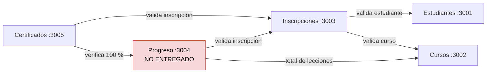

**Tecnologías:** Node.js + Express · PostgreSQL 16 · Docker · Docker Compose · Jest + Supertest · GitHub Actions

### Reglas de negocio

| Regla | Servicio | Respuesta si no se cumple |
|-------|----------|---------------------------|
| Email de estudiante único | Estudiantes | `409` |
| Precio ≥ 0 y número de lecciones > 0 | Cursos | `400` |
| El estudiante y el curso deben existir para inscribirse | Inscripciones | `400` |
| No se permite inscribir dos veces al mismo estudiante en el mismo curso | Inscripciones | `409` |
| El certificado solo se emite con el progreso al 100 % | Certificados | `400` |
| Solo un certificado por inscripción | Certificados | `409` |
| Si un servicio del que se depende no responde | Inscripciones, Certificados | `503` |

---

## 🗂️ Organización del repositorio y flujo de trabajo

- **Líder:** @JhimyMc, responsable de revisar, aprobar y fusionar los Pull Requests.
- **Protección de `main`:** ningún cambio entra directamente; todo pasa por **Pull Request con al menos 1 aprobación**.
- **Forks y ramas:** cada integrante trabajó en su **fork** y en una rama `feature/<microservicio>`, y envió su PR al repositorio central.
- **Integración continua:** cada PR ejecuta automáticamente la construcción de imágenes Docker y las pruebas.

```
usuario/mini-Udemy (fork)
   └── rama feature/<servicio> ──Pull Request──► JhimyMc/mini-Udemy (main)
                                                  ├─ CI: build + pruebas ✅
                                                  └─ Revisión y aprobación del líder
```

### Pull Requests fusionados

| PR | Autor | Contenido |
|----|-------|-----------|
| #1 | @JhimyMc | `docker-compose.yml` con los 5 servicios y sus 5 bases de datos |
| #2 | @JhimyMc | Microservicio Estudiantes |
| #3 | @JhimyMc | CI con GitHub Actions |
| #4 | @JhimyMc | Evidencias del líder en el README |
| #6 / #7 | @Luis-sketch993 | Microservicio Cursos y evidencias |
| #8 | @Daniel318767 | Microservicio Inscripciones y evidencias |
| #5 | @sakataaaaaa | Microservicio Certificados y evidencias |

---

## 🧪 Pruebas automatizadas

Las pruebas usan **Jest + Supertest** y se ejecutan dentro de cada contenedor:

```bash
docker compose exec <servicio> npm test
```

| ID | Microservicio | Funcionalidad que verifica | Comportamiento esperado |
|----|---------------|----------------------------|-------------------------|
| E1 | Estudiantes | `GET /health` | `200` y `servicio: "estudiantes"` |
| E2 | Estudiantes | Listar estudiantes | `200` y lista con registros |
| E3 | Estudiantes | `GET /estudiantes/1` | `200` y `id = 1` |
| E4 | Estudiantes | `GET /estudiantes/9999` | `404` "Estudiante no encontrado" |
| E5 | Estudiantes | `POST` sin email | `400` |
| E6 | Estudiantes | `POST` válido | `201` |
| E7 | Estudiantes | `POST` con email repetido | `409` |
| C1 | Cursos | `GET /health` | `200` y `servicio: "cursos"` |
| C2 | Cursos | Listar cursos | `200` y lista con registros |
| C3 | Cursos | `GET /cursos/1` | `200` y `total_lecciones = 3` |
| C4 | Cursos | `GET /cursos/9999` | `404` "Curso no encontrado" |
| C5 | Cursos | `POST` con `total_lecciones = 0` | `400` |
| C6 | Cursos | `POST` con precio negativo | `400` |
| C7 | Cursos | `POST` válido | `201` |
| I1 | Inscripciones | `GET /health` | `200` y `servicio: "inscripciones"` |
| I2 | Inscripciones | `GET /inscripciones/1` | `200` |
| I3 | Inscripciones | Inscripción válida (consulta Estudiantes y Cursos) | `201` |
| I4 | Inscripciones | Estudiante inexistente | `400` "El estudiante o curso no existe" |
| I5 | Inscripciones | Curso inexistente | `400` |
| I6 | Inscripciones | Inscripción duplicada | `409` |
| P1–P7 | Progreso | — | ❌ **No implementadas (servicio no entregado)** |
| X1 | Certificados | `GET /health` | `200` y `servicio: "certificados"` |
| X2 | Certificados | Progreso incompleto (33 %) | `400` "El curso no está completado" |
| X3 | Certificados | Inscripción inexistente | `400` |
| X4 | Certificados | Emitir con 100 %, verificar por código y rechazar duplicado | `201`, `200`, `409` |
| X5 | Certificados | Código inexistente | `404` |

**Resumen:** Estudiantes 7/7 ✅ · Cursos 7/7 ✅ · Inscripciones 6/6 ✅ · Certificados 5/5 ✅ (con Progreso levantado localmente) · Progreso 0/7 ❌

---

## ⚙️ Integración continua (GitHub Actions)

El archivo `.github/workflows/ci.yml` se ejecuta en cada **push** y **Pull Request** hacia `main`:

1. Descarga el código.
2. Detecta qué microservicios tienen código.
3. Valida el `docker-compose.yml`.
4. **Construye las imágenes Docker**.
5. Levanta los contenedores y espera a que cada API responda en `/health`.
6. **Ejecuta las pruebas** de cada microservicio.
7. Si algo falla, muestra los registros; al final detiene los contenedores.

---

## 📸 Evidencias

### Jhimy Mercado Caceres — @JhimyMc (Líder · Estudiantes · docker-compose · CI)

**Figura 1.** Protección de la rama `main` (Pull Request obligatorio con 1 aprobación)


**Figura 2.** Colaboradores del equipo


**Figura 3.** Pruebas del microservicio Estudiantes (7 pruebas aprobadas)


**Figura 4.** Pull Request #2 del microservicio Estudiantes, revisado y aprobado


**Figura 5.** Integración continua con GitHub Actions: construcción de imágenes y pruebas automáticas


---

### Luis Cristian Rafaele Huaman — @Luis-sketch993 (Cursos)

**Figura 1.** Creación de la rama `feature/cursos`


Se evidencia la creación correcta de la rama `feature/cursos`, destinada al desarrollo independiente del microservicio Cursos, manteniendo `main` como base del proyecto.

**Figura 2.** Verificación de la conexión entre Docker Desktop y Ubuntu


Se comprueba que Docker está operativo desde Ubuntu mediante la visualización de los contenedores activos.

**Figura 3.** Primer commit del microservicio Cursos


Se registra el primer avance: estructura inicial, conexión a PostgreSQL, dependencias y configuración de Docker.

**Figura 4.** Despliegue del microservicio Cursos con Docker Compose


Se evidencia la construcción de la imagen, la inicialización de PostgreSQL y el inicio correcto del contenedor.

**Figura 5.** Registros iniciales en PostgreSQL


Se evidencia la creación de la tabla `cursos` y la inserción de los tres registros definidos en `init.sql`.

**Figura 6.** Segundo commit del microservicio Cursos


Se incorpora el script SQL de creación y carga inicial, junto con los endpoints y validaciones de la API REST.

**Figura 7.** Pruebas automatizadas del microservicio Cursos (7 aprobadas)


Se ejecutan siete pruebas con Jest y Supertest, verificando endpoints, validaciones y el registro de cursos.

**Figura 8.** Pull Request del microservicio Cursos hacia el repositorio central


**Figura 9.** Revisión y aprobación del Pull Request


---

### Daniel Benjamin Quispirroca Benitez — @Daniel318767 (Inscripciones)

El microservicio **Inscripciones** (puerto 3003) registra la inscripción de un estudiante en un curso. Antes de guardar, consulta por HTTP a **Estudiantes** y a **Cursos** para validar que ambos existan, y evita inscripciones duplicadas.

| Método | Ruta | Descripción |
|--------|------|-------------|
| GET | `/health` | Estado del servicio |
| GET | `/inscripciones` | Lista todas las inscripciones |
| GET | `/inscripciones/:id` | Consulta una inscripción (404 si no existe) |
| POST | `/inscripciones` | Crea una inscripción (400 si el estudiante o curso no existe, 409 si ya está inscrito, 503 si no responde Estudiantes o Cursos) |
| DELETE | `/inscripciones/:id` | Elimina una inscripción |

**Figura 1.** Rama `feature/inscripciones` y commits del microservicio

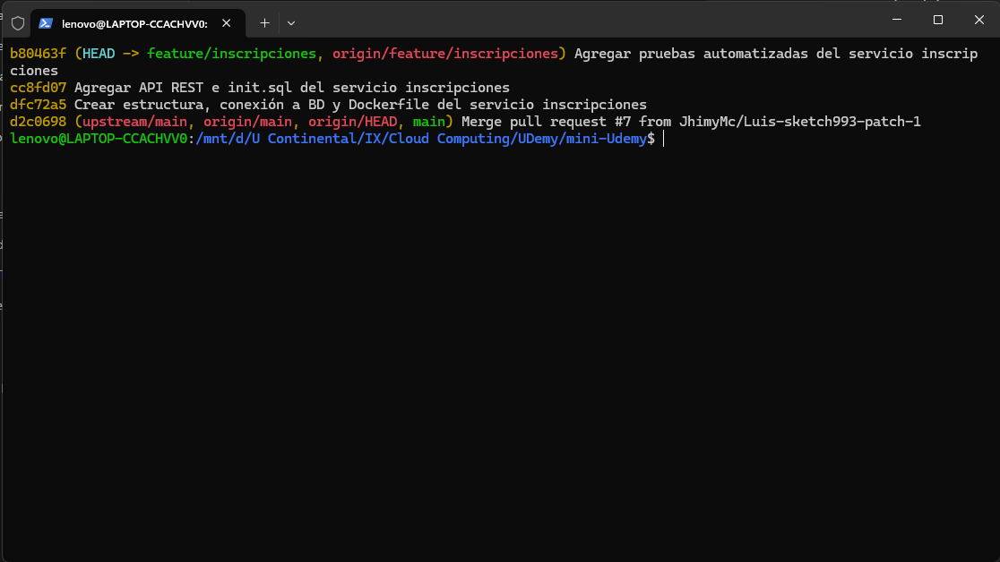

Se evidencia la rama `feature/inscripciones` subida a GitHub con sus tres commits: estructura y Dockerfile; API REST e `init.sql`; y pruebas automatizadas.

**Figura 2.** Despliegue con Docker Compose desde Ubuntu (WSL)

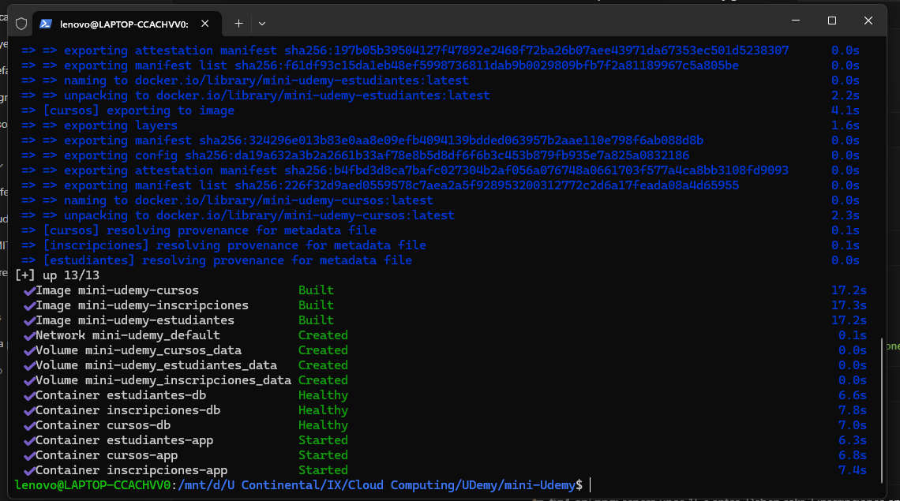

Se construyen e inician los contenedores de Estudiantes, Cursos e Inscripciones, con sus bases de datos en estado *Healthy*.

**Figura 3.** Consulta de las inscripciones iniciales

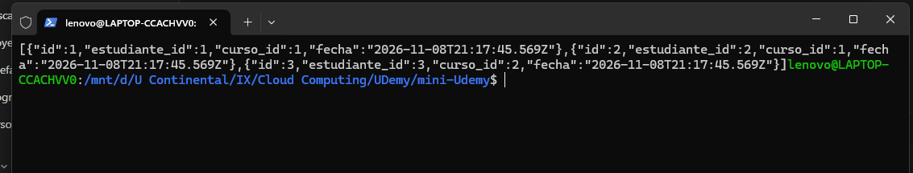

Respuesta de `GET /inscripciones` con los tres registros iniciales.

**Figura 4.** Pruebas automatizadas (6 aprobadas)

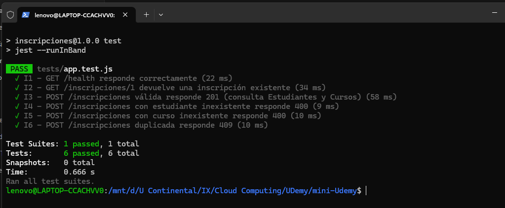

Se verifican la validación contra Estudiantes y Cursos, el rechazo de datos inexistentes y de inscripciones duplicadas.

**Figura 5.** Pull Request y verificación automática con GitHub Actions

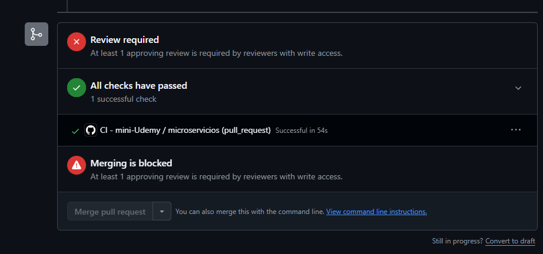

El flujo CI construye las imágenes, levanta los contenedores y ejecuta las pruebas con resultado exitoso.

---

### Edwards Andree Ochoa Cutipa — @andres8a21 (Progreso)

❌ **Sin entregas.** No se registraron commits, rama ni Pull Request del microservicio Progreso en el repositorio central. La carpeta `progreso/` permanece vacía.

---

### Urpi Radhakrisna Pilco Del Alamo — @sakataaaaaa (Certificados)

El microservicio **Certificados** (puerto 3005) emite el certificado cuando el progreso llega al 100 %. Antes de guardarlo, consulta a **Inscripciones** y a **Progreso**. Cada certificado recibe un código único `MU-XXXXXXXX` que un empleador puede verificar.

| Método | Ruta | Descripción |
|--------|------|-------------|
| GET | `/health` | Estado del servicio |
| GET | `/certificados` | Lista todos los certificados |
| GET | `/certificados/:id` | Consulta un certificado (404 si no existe) |
| GET | `/certificados/codigo/:codigo` | Verifica un certificado por su código (404 si no existe) |
| POST | `/certificados` | Emite un certificado (400 si la inscripción no existe o el curso no está completado, 409 si ya existe, 503 si no responde Inscripciones o Progreso) |
| DELETE | `/certificados/:id` | Elimina un certificado |

**Figura 1.** Fork del repositorio en GitHub

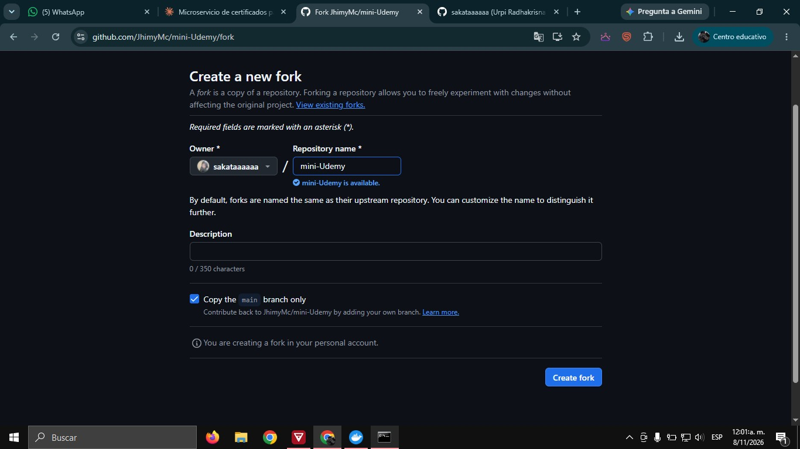

Fork `sakataaaaaa/mini-Udemy` creado a partir de `JhimyMc/mini-Udemy`.

**Figura 2.** Remotos `origin` y `upstream`

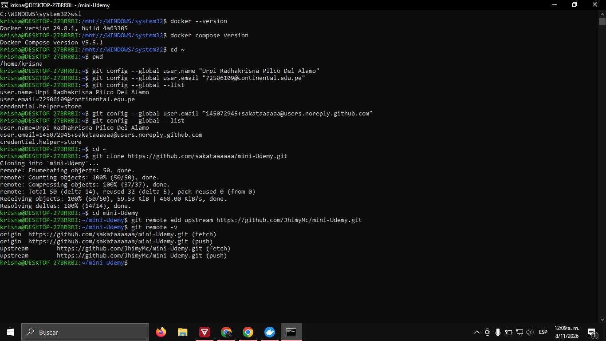

Repositorio clonado con el remoto `origin` (fork) y `upstream` (repositorio del líder).

**Figura 3.** Rama `feature/certificados`

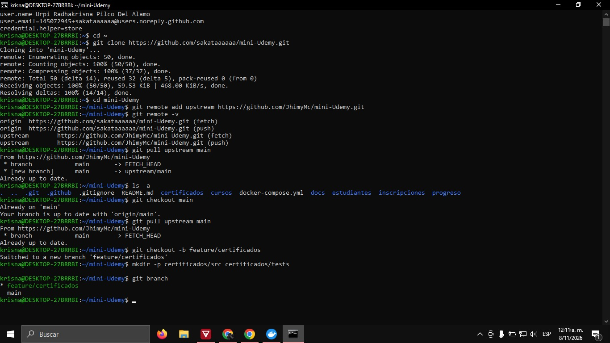

**Figura 4.** Commits del microservicio

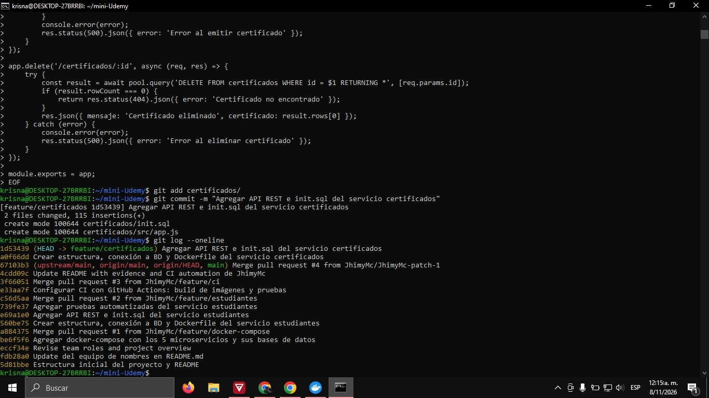

**Figura 5.** Despliegue con Docker Compose

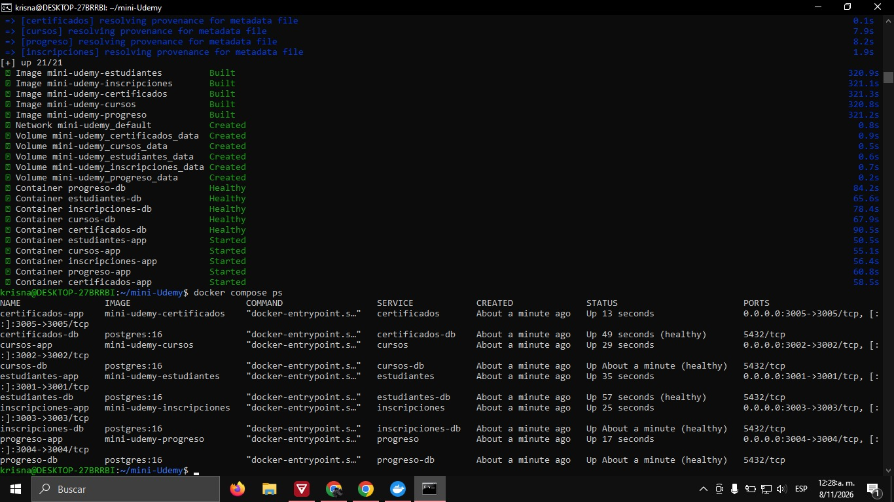

**Figura 6.** Pruebas automatizadas (5 aprobadas)

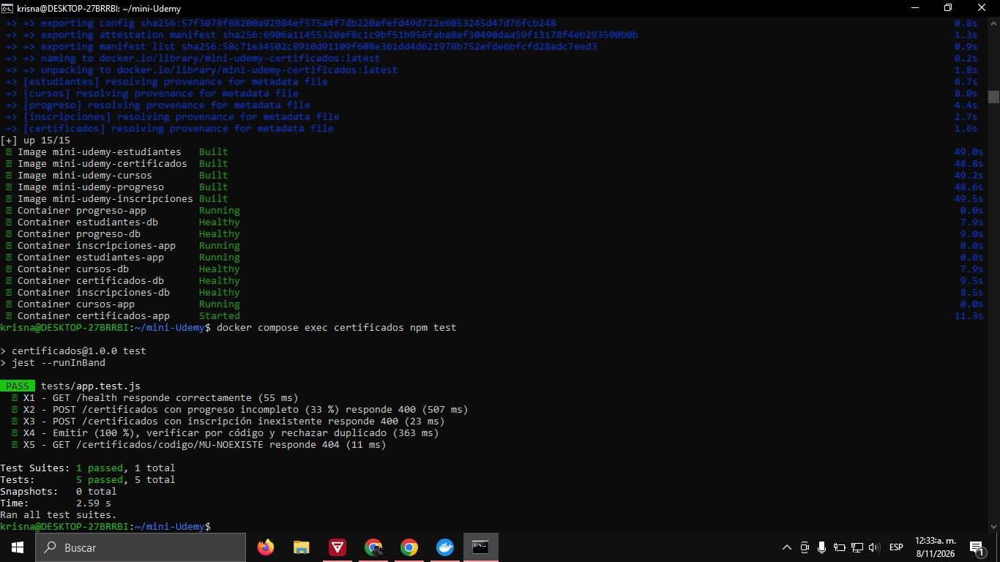

Se verifican la emisión, la verificación por código, el rechazo de cursos incompletos y de certificados duplicados.

**Figura 7.** Emisión, verificación y rechazo de certificados

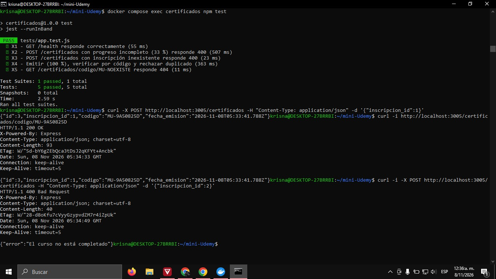

Emisión para una inscripción al 100 % (código `MU-9A50825D`), verificación por código (`200`) y rechazo de una inscripción al 33 % (`400`, "El curso no está completado").

**Figura 8.** Commits y push de la rama

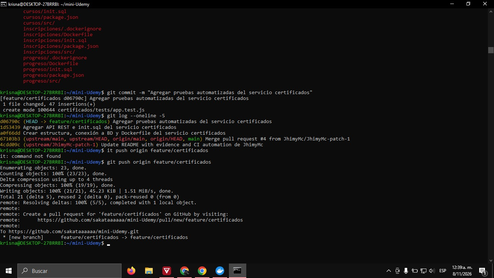

---

## ⚠️ Estado actual y limitaciones

El microservicio **Progreso** no fue entregado, y esto afecta al flujo completo de la plataforma:

| Funcionalidad | Estado |
|---------------|--------|
| Registrar y consultar estudiantes | ✅ Funciona |
| Consultar y gestionar cursos | ✅ Funciona |
| Inscribir estudiantes en cursos | ✅ Funciona |
| Registrar avance de lecciones y calcular % | ❌ No disponible |
| Emitir certificados | ❌ Falla: Certificados no puede consultar el % de avance y responde `503 "No se pudo contactar a Inscripciones o Progreso"` |
| Verificar un certificado por código | ✅ Funciona para certificados ya emitidos |

Aun así, el caso demuestra una ventaja de la arquitectura de microservicios: **la falta de un servicio no detiene a los demás**. Estudiantes, Cursos e Inscripciones siguen funcionando con normalidad; solo se pierde la funcionalidad que depende directamente de Progreso.

---

## ▶️ Cómo ejecutar el proyecto

```bash
git clone https://github.com/JhimyMc/mini-Udemy.git
cd mini-Udemy

# Levantar los servicios disponibles
docker compose up -d --build estudiantes cursos inscripciones

# Probar
curl http://localhost:3001/estudiantes
curl http://localhost:3002/cursos
curl http://localhost:3003/inscripciones

# Pruebas
docker compose exec estudiantes npm test
docker compose exec cursos npm test
docker compose exec inscripciones npm test

# Detener
docker compose down -v
```
